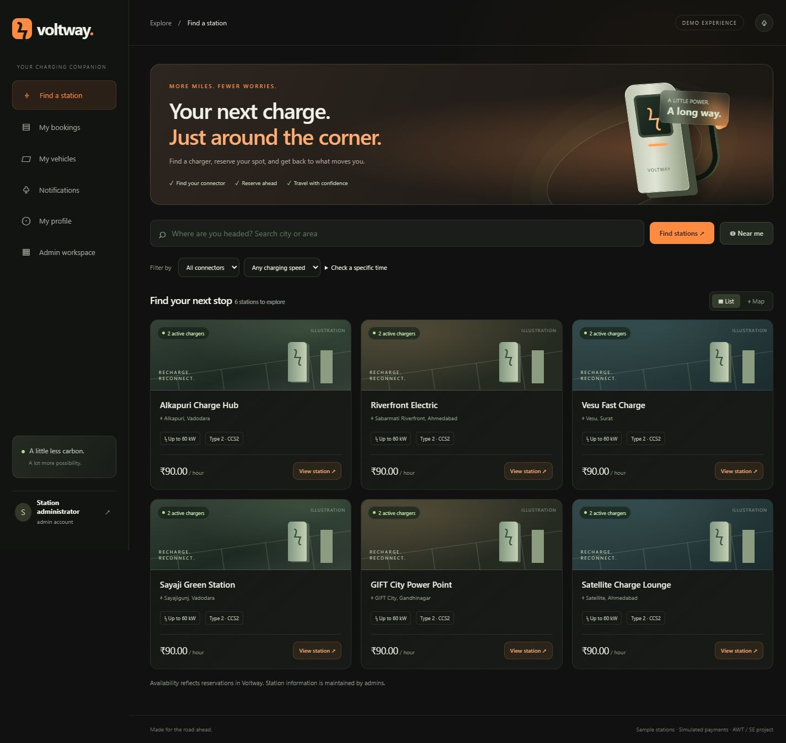
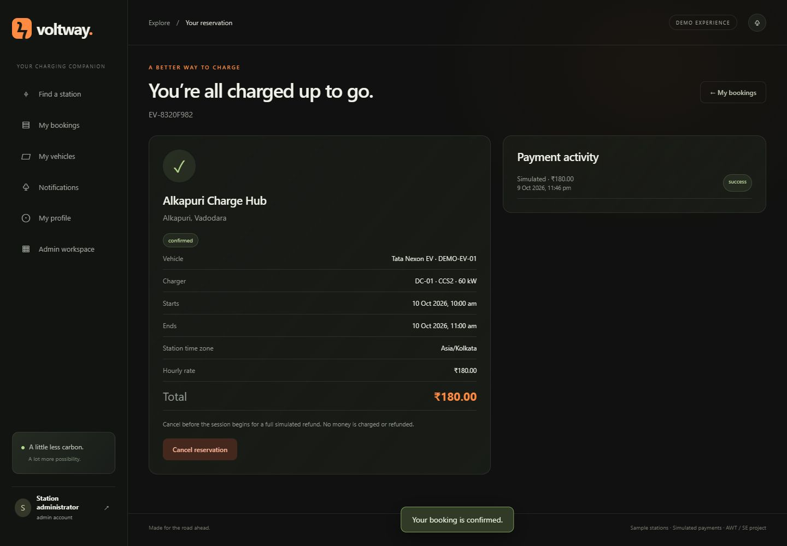
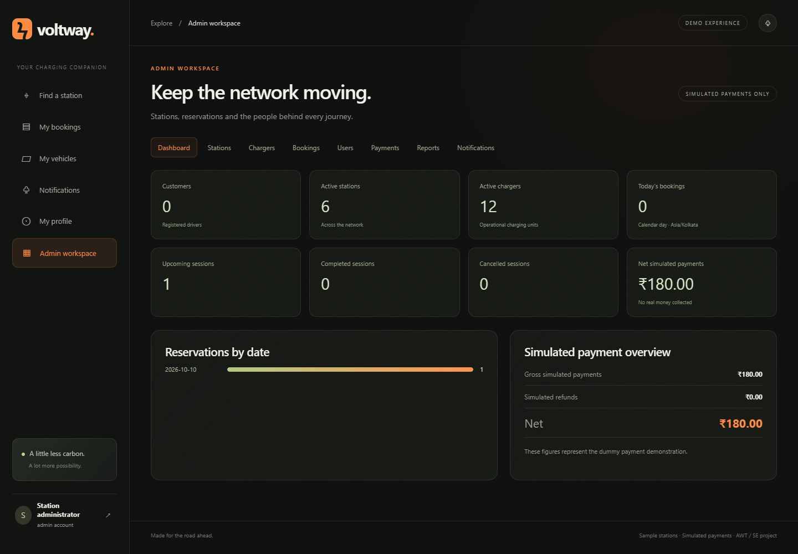
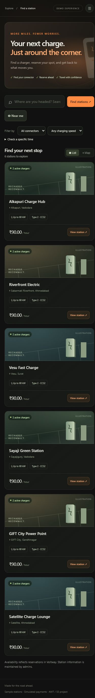
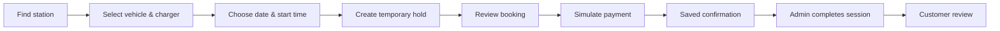

<div align="center">

# ⚡ VOLTWAY

### EV Charging Station Finder & Slot Booking

**Find your charger. Reserve your time. Keep moving.**


A full-stack academic project with a **dark & orange glass interface**, map-based station discovery, transactional reservations, simulated payments, and an admin workspace.

[Features](#-features) · [Quick Start](#-quick-start) · [Tech Stack](#-tech-stack) · [Testing](#-testing) · [Documentation](#-documentation)

</div>

---

## 🖼️ Project Preview



<details>
<summary><strong>View booking confirmation, admin dashboard and mobile preview</strong></summary>

### Booking confirmation



### Admin dashboard



### Mobile experience



</details>

_Screenshots show the earlier isolated demo. Vehicle selection and shared glass styling have since been updated._

## ✨ Features

| For drivers                                       | For administrators                             |
| ------------------------------------------------- | ---------------------------------------------- |
| Search stations by city or area                   | Add and edit stations and chargers             |
| Filter connectors, power and time availability    | Manage operating status and hourly pricing     |
| Explore stations on a Leaflet map                 | Inspect bookings and advance session status    |
| Save vehicles and find compatible chargers        | Activate or deactivate customer accounts       |
| Reserve charging time with a temporary hold       | View simulated payments and refunds            |
| Simulate payment success or failure               | Track booking and payment statistics           |
| View booking history and cancel eligible sessions | Filter reports and export CSV                  |
| Review completed sessions and read notifications  | Receive booking and cancellation notifications |

### Built for reliable reservations

- **Atomic time-block claims** prevent overlapping reservations, including concurrent requests.
- **Five-minute payment holds** expire without depending on background cleanup timing.
- **Saved price, station and vehicle snapshots** preserve booking history when records change.
- **Idempotent payments and refunds** prevent duplicate successful records.
- **Explicit page routes** validate record IDs, enforce access guards and handle invalid links.
- **Responsive glass surfaces** span customer and admin pages, with a solid-background fallback.

> **Demo payment — no real money will be charged.** Stations supplied by the seed script are demonstration records. This project does not control physical chargers or receive live telemetry.

## 🧰 Tech Stack

| Layer                 | Technology                                         | Purpose                                               |
| --------------------- | -------------------------------------------------- | ----------------------------------------------------- |
| Frontend              | HTML5, CSS3, JavaScript ES modules                 | Pages, glass styling and browser interactions         |
| Responsive layout     | Bootstrap 5                                        | Layout utilities and components                       |
| Backend               | Node.js 22+, Express 5                             | HTTP APIs, middleware and application lifecycle       |
| Database              | MongoDB Atlas, Mongoose 8                          | Persistent records, schemas, indexes and transactions |
| Authentication        | express-session, connect-mongo, bcryptjs           | Server-side sessions and password hashing             |
| Validation & security | Zod, Helmet, express-rate-limit                    | Request validation, security headers and throttling   |
| Maps                  | Leaflet, OpenStreetMap tiles                       | Station markers and interactive maps                  |
| Dates & time zones    | Luxon                                              | UTC storage and station-local booking times           |
| Testing               | Node test runner, Supertest, mongodb-memory-server | API, concurrency and frontend-logic checks            |
| Formatting            | Prettier                                           | Consistent source formatting                          |

## 🚀 Quick Start

For a complete local installation or a handoff to any AI coding assistant, follow **[SETUP.md](SETUP.md)**. It includes a persistent local MongoDB replica set, frontend/backend startup, verification, and troubleshooting. Owner credentials are supplied separately and are not included in that guide.

### 1. Clone and install

```bash
 git clone https://github.com/tirthgandhi/ev-charging-station-finder.git
 cd ev-charging-station-finder
 npm install
```

Requires **Node.js 22+**. For persistent storage, use **MongoDB Atlas** or a local MongoDB **replica set**. Standalone MongoDB does not support the transactions used for reservations.

### 2. Choose how to run

<details open>
<summary><strong>Option A — Persistent Atlas database</strong></summary>

Copy `.env.example` to `.env`:

```powershell
# Windows PowerShell
Copy-Item .env.example .env
```

```bash
# macOS / Linux
cp .env.example .env
```

Set these values in your private `.env`:

| Variable         | Value                                                |
| ---------------- | ---------------------------------------------------- |
| `MONGODB_URI`    | Your database connection string with a database name |
| `SESSION_SECRET` | A random secret of at least 32 characters            |
| `ADMIN_EMAIL`    | Your administrator email                             |
| `ADMIN_PASSWORD` | A strong password of at least 12 characters          |
| `APP_BASE_URL`   | `http://localhost:3000` for local development        |
| `HOST`           | `127.0.0.1` for access from this PC only             |

Generate a session secret:

```bash
node -e "console.log(require('crypto').randomBytes(32).toString('hex'))"
```

Check the connection, create sample records, and start:

```bash
npm run db:check
npm run seed
npm start
```

Open **[localhost:3000](http://localhost:3000)**. Sign in using the administrator credentials you configured, or register a customer through the interface.

The seed script creates **six sample stations and twelve chargers**. It preserves existing records and does not reset an existing administrator's password. Public registration always creates customer accounts.

**Already configured locally?** Keep your existing `.env`; run `npm run db:check` followed by `npm start`.

</details>

<details>
<summary><strong>Option B — Temporary demo without installing MongoDB manually</strong></summary>

```bash
npm run preview
```

The first run downloads the MongoDB test binary and starts an isolated local replica set. Open **[localhost:3000](http://localhost:3000)**.

| Demo login | Value                |
| ---------- | -------------------- |
| Email      | `admin@voltway.demo` |
| Password   | `Voltway-Demo-2026`  |

These credentials apply **only to the isolated demo**. Its database is deleted when stopped. Use Option A for persistent records; do not deploy the preview script.

</details>

## 🔄 Booking Flow



All active saved vehicles remain visible. The app prefers the newly saved vehicle and selects a compatible operational charger when available. Connector mismatches are explained, and incompatible reservations are blocked by both frontend and backend.

**Select a green start-time button before booking.** The selected slot turns orange. Continue guides you back to the slot picker if no time is selected.

| Policy                | Default behavior                                         |
| --------------------- | -------------------------------------------------------- |
| Reservation interval  | 30-minute blocks                                         |
| Booking horizon       | Up to 30 days ahead                                      |
| Payment hold          | Five minutes                                             |
| Price                 | Hourly rate × reserved duration; stored in integer paise |
| Customer cancellation | Before the session starts                                |
| Refund                | Full simulated refund for eligible paid cancellations    |
| Reviews               | One per completed booking                                |
| Completion            | Admin: confirmed → in progress → completed               |

Block size, horizon and hold duration are configurable. Timestamps are stored in UTC and displayed in the station's time zone. Each station has one daily operating window; overnight windows are not supported. Report date filters use UTC; the dashboard's today count uses Asia/Kolkata.

## 🧪 Testing

| Command                              | What it checks                                                               |
| ------------------------------------ | ---------------------------------------------------------------------------- |
| `npm test`                           | Integration tests on a temporary local replica set plus frontend logic tests |
| `npm run test:atlas`                 | APIs against an isolated disposable Atlas test database                      |
| `node --test tests/frontend.test.js` | Vehicle selection and client route resolution                                |
| `npm run privacy:check`              | Deliverable source for configured private values                             |
| `npm run format:check`               | Source formatting                                                            |

**Recorded verification:** 13 Atlas integration test groups passed, all 37 declared API endpoints returned successful responses, and seven vehicle-selection/route checks passed. These are recorded results, not a live CI status. See [test cases](docs/test-cases.md) and [endpoint verification](docs/atlas-verification.md) for scope and limitations.

The Atlas test runner creates a uniquely named `voltway_test_…` database, refuses an existing test database, and removes only the database it created. It does not use your application records as fixtures. The database user must have permission to create and remove that test database.

## 🔐 Security & Privacy

- Passwords are hashed; sessions are stored in MongoDB and regenerated after login.
- Cookie-authenticated changes require a CSRF token. Private records require ownership checks; admin APIs require an active admin.
- Login throttling, validated inputs, permitted update fields and escaped user content protect API and UI boundaries.
- `.env` is Git-ignored and excluded from generated project ZIPs. Never commit database credentials, session secrets or administrator passwords.
- Git ignore rules do not prevent cloud-folder syncing. Keep private configuration outside synced folders if device-only storage is required.
- A private environment file does not change GitHub repository visibility. Rotate credentials if they have been shared or exposed.

## 📁 Project Structure

```text
ev-charging-station-finder/
├── public/
│   ├── index.html                 # Application shell
│   └── assets/
│       ├── app.js                 # Customer screens
│       ├── admin.js               # Admin workspace
│       ├── routes.js              # Explicit page route registry
│       ├── booking-selection.js   # Vehicle/charger matching
│       ├── api.js                 # API client and safe display helpers
│       └── style.css              # Responsive glass design
├── src/
│   ├── app.js                     # APIs, middleware and authorization
│   ├── server.js                  # Startup and shutdown
│   ├── config.js                  # Environment configuration
│   ├── validation.js              # Request schemas
│   ├── models/index.js            # Collections and indexes
│   └── services/booking.js        # Transactional booking logic
├── scripts/                       # Seed, preview, Atlas checks and packaging
├── tests/                         # Integration and frontend logic tests
├── docs/                          # API, diagrams, screenshots and test evidence
├── .env.example                   # Placeholder configuration only
└── package.json
```

## 📚 Documentation

| Guide                                              | Contents                                             |
| -------------------------------------------------- | ---------------------------------------------------- |
| [Requirements](docs/requirements.md)               | Objectives, actors, scope and limitations            |
| [Implementation plan](docs/implementation-plan.md) | Backend-first development parts                      |
| [Database design](docs/database-design.md)         | Collections, relationships, indexes and transactions |
| [API reference](docs/api.md)                       | Endpoints, request fields and access rules           |
| [Page routes](docs/routes.md)                      | Customer/admin routes and navigation behavior        |
| [SE diagrams](docs/diagrams.md)                    | Use cases, activities, sequences, classes and DFDs   |
| [Test cases](docs/test-cases.md)                   | Checks, results and browser evidence                 |
| [Atlas verification](docs/atlas-verification.md)   | API coverage and verification limits                 |

## ☁️ Deployment

Use a Node.js host, MongoDB Atlas and HTTPS. Configure `NODE_ENV=production`, `MONGODB_URI`, `SESSION_SECRET`, `APP_BASE_URL`, `HOST` and `PORT` in the hosting environment.

```bash
npm ci --omit=dev
npm start
```

- The app assumes **one trusted reverse-proxy hop**. Match the host's proxy configuration.
- Keep `HOST=127.0.0.1` behind a same-machine reverse proxy; use your provider's required bind address for container hosting.
- `GET /api/health` returns 200 while MongoDB is connected.
- Preserve the session secret across restarts; configure database backups, restricted network access and host logging.
- Holds are cleaned up every 30 seconds. Availability and payment checks also enforce expiry directly.
- Seed from a controlled environment, then remove seed-only admin variables from the deployed runtime.

**Public hosting is not provisioned by this repository.**

<details>
<summary><strong>Map troubleshooting</strong></summary>

Tiles use the canonical OpenStreetMap endpoint, visible attribution and `strict-origin-when-cross-origin` referrer policy. Restart the Node server after response-header changes, then reload the page. If tiles cannot load, a fallback message and OpenStreetMap link appear; station addresses and bookings remain usable.

Choose a tile provider suitable for expected deployment traffic and update the CSP allowlist if changing providers. Respect provider usage policies; do not proxy around access blocks.

</details>

## 🌱 Future Scope

Live charger telemetry · Operator accounts · QR check-in · Real payment integration · Email/SMS updates · Measured energy billing · Route planning

---

<div align="center">

**Built for Advanced Web Technology & Software Engineering**
⚡ Less waiting. More moving.

</div>
