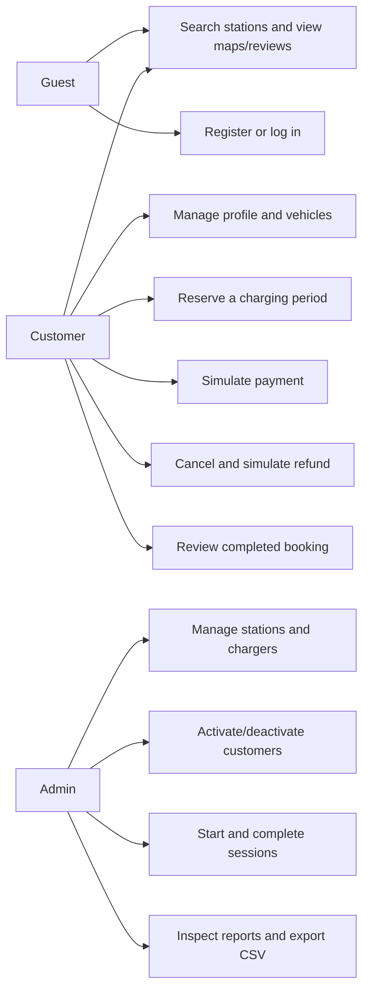
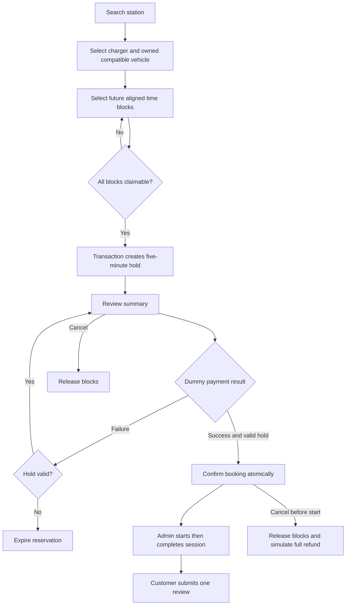
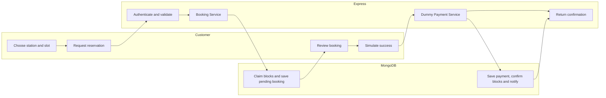
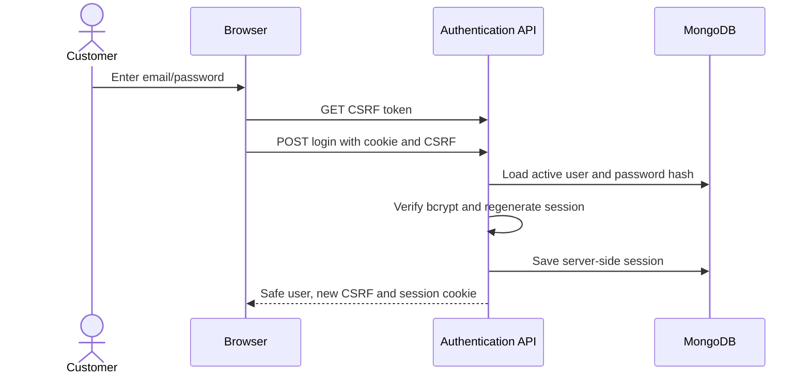
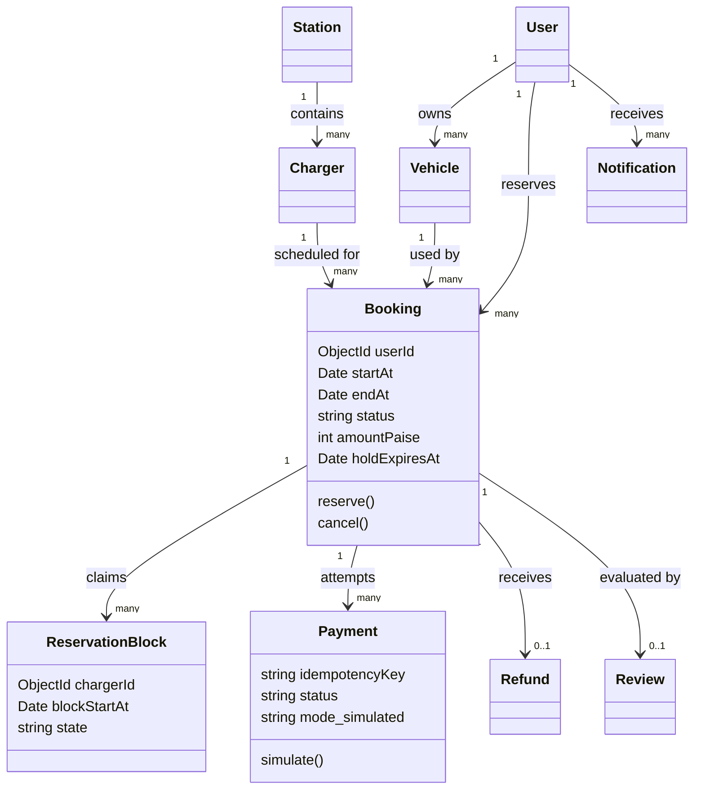
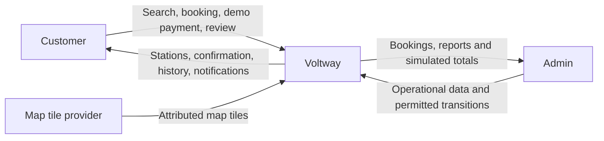
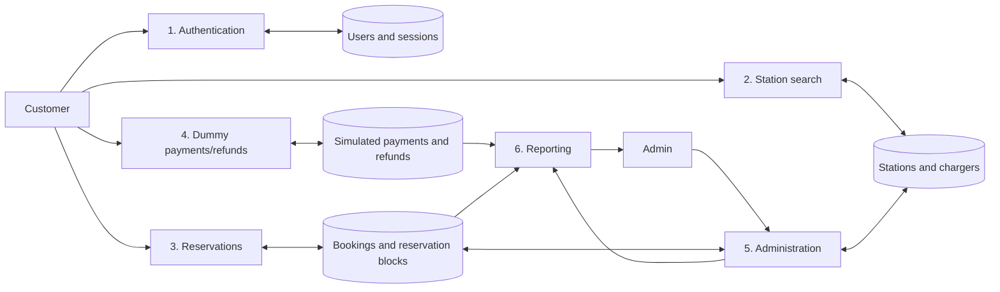
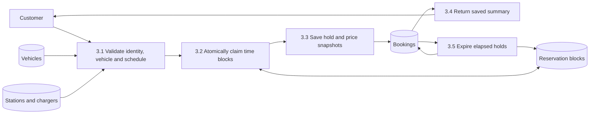

# Software Engineering diagrams

Mermaid source is rendered by GitHub. The payment actor is an internal Dummy Payment Service, never an external gateway.

## Use cases



## Booking activity



## Swimlanes



## Login sequence



## Reservation sequence

```mermaid
sequenceDiagram
 actor Customer
 participant Browser
 participant Service as Booking Service
 participant DB as MongoDB replica set
 Customer->>Browser: Choose charger, vehicle and times
 Browser->>Service: POST booking (no authoritative price)
 Service->>DB: Begin transaction
 Service->>DB: Validate owner, connector and operational records
 Service->>Service: Validate time zone/hours; calculate price
 Service->>DB: Remove expired requested claims
 Service->>DB: Insert all uniquely indexed blocks
 alt Any block conflicts
 DB-->>Service: Duplicate claim
 Service->>DB: Abort transaction
 Service-->>Browser: 409 choose another slot
 else All claims succeed
 Service->>DB: Save booking and snapshots; commit
 Service-->>Browser: Saved reference and hold expiry
 end
```

## Dummy payment sequence

```mermaid
sequenceDiagram
 participant Browser
 participant Dummy as Dummy Payment Service
 participant DB as MongoDB
 Browser->>Dummy: outcome + idempotency key
 Dummy->>DB: Begin transaction; load owned booking
 Dummy->>DB: Check existing key/successful payment
 alt Existing result
 Dummy-->>Browser: Return saved result
 else Valid pending hold
 Dummy->>DB: Record simulated payment
 alt Success
 Dummy->>DB: Confirm booking/blocks and add notifications
 else Failed
 Dummy->>DB: Retain pending hold
 end
 Dummy->>DB: Commit
 Dummy-->>Browser: Saved payment and booking
 else Expired or invalid
 Dummy-->>Browser: Reject with 409
 end
```

## Class and collection relationships



## Context diagram



## Level-0 DFD



## Level-1 reservation DFD


